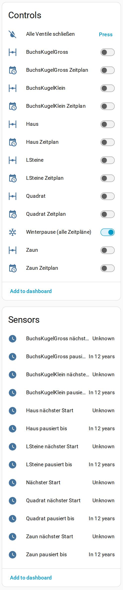

# Schedules & control for GARDENA smart – Home Assistant (unofficial)

> **Independent hobby project** – not affiliated with, endorsed or supported by GARDENA or Husqvarna Group.
> "GARDENA" is used only to describe compatibility; see [Disclaimer](#disclaimer).

Custom integration that talks to the **same cloud API the GARDENA smart app uses**
(`smart.gardena.com/v1`). The official GARDENA smart system API can only open/close
valves and pause schedules for a few hours. This integration adds what the app can do:

- **Schedules per valve**: switch on/off (off = paused *until further notice*, exactly like the app)
- **Winter pause**: one switch pauses every valve schedule
- Pause for N hours / until a date, resume
- **Read, add, change and delete schedule entries** (services)
- Next scheduled start per valve, with the full schedule as attributes
- Valves: open for an adjustable manual duration, close, close all
- Device health: online, last seen, firmware status, radio quality, valve errors
- Gateway: online, IP address, WLAN
- GARDENA smart **Sensor** (soil moisture, soil/ambient temperature, light, battery, "measure now"),
  **Water Control** and **Power** socket are picked up automatically when present

## Screenshot



*Device page (German UI): one valve and one schedule switch per valve, winter pause, next start and pause-until sensors.*

## Requirements

A Husqvarna developer application (Application key + secret) with the
*Authentication API* and *GARDENA smart system API* connected – the same one the
official GARDENA smart system integration needs. If that integration is already set up,
its key and secret are offered automatically. No app password is stored.

## Installation

HACS → Custom repositories → `https://github.com/quitkelvin/ha-gardena-app` (Integration),
install, restart Home Assistant, then *Settings → Devices & services → Add integration → Schedules & control for GARDENA smart (unofficial)*.

Polling interval defaults to 10 minutes (options). Writes refresh immediately.

## Services (target: a valve "Zeitplan"/schedule switch)

| Service | Fields |
|---|---|
| `gardena_app.pause_schedule` | `until` (datetime) or `hours`; empty = until further notice |
| `gardena_app.resume_schedule` | – |
| `gardena_app.add_schedule` | `start` `HH:MM`, `end` `HH:MM`, `weekdays` |
| `gardena_app.update_schedule` | `event_id`, optional `start`, `end`, `weekdays` |
| `gardena_app.delete_schedule` | `event_id` (see the switch attribute `zeitplan`) |

```yaml
action: gardena_app.add_schedule
target:
  entity_id: switch.irrigation_control_app_lawn_zeitplan
data:
  start: "06:00"
  end: "06:15"
  weekdays: [monday, wednesday, friday]
```

## Disclaimer

This project is **not affiliated with, endorsed or supported by GARDENA, Husqvarna Group**
or any of their subsidiaries. "GARDENA" is a trademark of its owner and is used only to
describe compatibility; no logos are used and no official status is implied. The app API used here is undocumented and may change or stop
working at any time. Use at your own risk – a wrong schedule can water at the wrong time
or not at all. Keep an eye on your garden after changes.

Thanks to the FHEM GardenaSmartBridge/GardenaSmartDevice modules, whose public
documentation of the app API made this possible (no code was copied).

**Kurzfassung (DE):** Unabhängiges Hobbyprojekt – **keine** Verbindung zu GARDENA oder der Husqvarna Group,
nicht von ihnen unterstützt oder geprüft. „GARDENA“ ist eine Marke ihres Inhabers und wird nur zur Angabe der
Kompatibilität genannt. Die App-API ist undokumentiert und kann sich jederzeit ändern. Nutzung auf eigene Gefahr.

## License

MIT – see [LICENSE](LICENSE). No third-party code is included and no Python packages are required
(manifest `requirements: []`); the FHEM modules mentioned above were used as documentation only.
